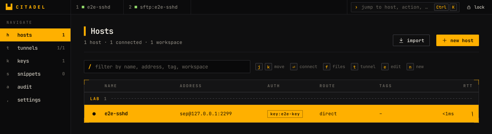

# Citadel

**Your servers, keys and tunnels in one encrypted file, on your machine.**
Citadel is a free, open-source SSH client, tunnel manager and SFTP browser for
Windows, macOS, Linux and Android. No account, no cloud, no telemetry.

[](https://github.com/sepehrmohseni/citadel/releases/latest)
[](https://github.com/sepehrmohseni/citadel/releases)
[](https://github.com/sepehrmohseni/citadel/actions/workflows/ci.yml)
[](#license)

**[Download](https://github.com/sepehrmohseni/citadel/releases/latest)** ·
[Website](https://sepehrmohseni.github.io/citadel/) ·
[Install guide](docs/INSTALL.md) ·
[Report a bug](https://github.com/sepehrmohseni/citadel/issues/new?labels=bug)



## Why Citadel

- **One encrypted file, nothing shared.** Hosts, keys, tunnels and trusted host
  keys live in a vault encrypted with your password (Argon2id and
  XChaCha20-Poly1305). There is no Citadel server to sign up for or trust.
- **Bastions and tunnels that keep working.** Multi-hop jump chains, local,
  remote and SOCKS forwards that come back on their own after a dropped
  connection, and a port detector that forwards a new dev server in one click.
- **One command, every host.** Fleet run executes a command on many servers at
  once and groups identical output, failures first.
- **SSH keys other clients reject.** OpenSSH, PuTTY `.ppk`, PKCS#8 and pasted
  keys with broken line endings, agents including 1Password and Bitwarden, and
  legacy appliances when you switch them on.
- **Every keyboard and language.** Shortcuts and `Ctrl` keys work on any layout,
  and Persian, Arabic and Hebrew render right to left in the terminal.
- **Stays up to date, safely.** Signed updates install when you quit, and bugs
  are reported to GitHub from inside the app.

Citadel is in beta. File formats are versioned, and every build must still
open vaults written by the first release. Optional sync
uses storage you control: an S3-compatible bucket, a WebDAV share or a Git
repository.

The core is written in Rust. The interface is a Tauri v2 application using the
system webview, xterm.js with the WebGL renderer, and vanilla TypeScript.

## Install

Linux and macOS:

```sh
curl -fsSL https://sepehrmohseni.github.io/citadel/install.sh | sh
```

Windows (PowerShell, no administrator rights needed):

```powershell
irm https://sepehrmohseni.github.io/citadel/install.ps1 | iex
```

The scripts fetch the latest release, verify it against the release's
`SHA256SUMS`, and install it with a Start menu entry and desktop shortcut on
Windows, an Applications bundle on macOS, and a package or AppImage with a
menu entry on Linux. Manual downloads, uninstalling, unsigned-build warnings
and signing are covered in [docs/INSTALL.md](docs/INSTALL.md).

Or download the installer yourself from the
[latest release](https://github.com/sepehrmohseni/citadel/releases/latest):

| Platform | File |
| --- | --- |
| Windows 10 and 11 | `Citadel_<version>_x64-setup.exe` |
| macOS 11 or later (Apple Silicon and Intel) | `Citadel_<version>_universal.dmg` |
| Ubuntu, Debian | `Citadel_<version>_amd64.deb` |
| Fedora, RHEL, openSUSE | `Citadel-<version>-1.x86_64.rpm` |
| Any Linux | `Citadel_<version>_amd64.AppImage` |
| Android 7 or later | `Citadel_<version>_android.apk` |

The installers are not code-signed yet, so the first launch asks once:

- **Windows:** "Windows protected your PC" → **More info** → **Run anyway**.
- **macOS:** System Settings → Privacy & Security → **Open Anyway** (on macOS 14
  and earlier, Control-click the app and choose **Open**).
- **Android:** allow installs from your browser when Android asks.

The install scripts above avoid the Windows and macOS prompts.

Android: download `Citadel_<version>_android.apk` from the
[latest release](https://github.com/sepehrmohseni/citadel/releases/latest) on
the phone and open it.

## Updates

Citadel looks for a new release on GitHub shortly after it starts and then
every six hours. Settings › About › Updates chooses what happens next:

- **Install automatically** (the default): the update downloads in the
  background and installs when you quit Citadel. A notice offers to restart
  now instead; Citadel never restarts by itself, and before a restart it says
  how many connected sessions will close. Tabs come back afterwards.
- **Ask before installing**: Citadel says a new version is out and downloads
  it only when you ask.
- **Don't check**: no automatic checks. "Check now" still works.

Every update is signed with the project's update key, and Citadel refuses any
file whose signature does not match the public key built into it. Windows
installers, macOS and the AppImage install without questions. The `.deb` and
`.rpm` packages ask for your system password, so Citadel downloads them in the
background and installs when you say so. Android and development builds cannot
replace themselves: they say that a new version is out and link to the
download. A version can be skipped from the notice.

The check requests the public release information from GitHub. Nothing about
you, your machine or your vault is sent; it is the only request Citadel makes
on its own.

## Reporting bugs

Settings › About › Report a bug (or "Report a bug" in the command palette)
asks for a title and what happened, and opens a new issue on GitHub with your
text already filled in, plus the version, operating system and package type if
you leave that ticked. Review it and press Submit on GitHub. Issues are public:
leave out passwords, keys and host names. Security problems go through
[GitHub Security Advisories](SECURITY.md) instead.

Filing the issue without the browser step would need a GitHub token inside the
app, and anyone could extract that token from the download and misuse it.

## Features

- Encrypted local vault: Argon2id key derivation, XChaCha20-Poly1305 per
  record, automatic locking that background work cannot hold off, and password
  changes that re-encrypt every record under a fresh key and carry over to
  synced devices.
- Password-protected export and import in a documented binary format
  (`.ctdl`).
- Multi-hop jump chains built in memory over `direct-tcpip` channels. Each hop
  verifies its host key and authenticates independently.
- Local (`-L`), remote (`-R`) and dynamic SOCKS5 (`-D`) forwarding. Local
  listeners stay bound while the underlying session reconnects; remote
  forwards are re-registered after every reconnect.
- Connection supervision with keepalive heartbeats and exponential backoff
  with jitter.
- Per-host identities. Agent forwarding exposes only the key assigned to that
  host, never the rest of your agent.
- Pipelined SFTP transfers and atomic remote edits.
- Agentless host telemetry from `/proc`, `df` and the Docker socket over the
  existing SSH session.
- Lossless round-tripping of `~/.ssh/config`, and discovery of the native,
  1Password and Bitwarden SSH agents.
- Live round-trip latency per connected host, measured with SSH-level
  `keepalive@openssh.com` probes every five seconds.
- A local security audit that grades the vault A to F: weak or DSA keys,
  password logins, agent forwarding, tunnels exposed beyond loopback,
  plaintext sync endpoints, disabled auto-lock and below-target KDF cost.
- Broadcast input across selected terminals, and session recording to
  asciicast v2 (`.cast`). Recordings capture output only, never keystrokes.
- Keyboard-first interface: `g` leader navigation, `j`/`k` host selection,
  a command palette with `user@host:port` quick connect, and six terminal
  themes. Pasting a full `ssh -p 2222 user@host` command into the palette or
  the host form fills in the connection.
- Works on every keyboard layout. Shortcuts, `Ctrl` control characters and
  `Alt` meta keys resolve by physical key when a non-Latin layout such as
  Persian, Arabic, Hebrew, Russian or Greek is active. Copy and paste use the
  native clipboard (`Ctrl+Shift+C`/`V`, `Ctrl+Insert`/`Shift+Insert`, or the
  right-click menu). Remote shells receive a UTF-8 locale so readline edits
  multi-byte characters correctly, and runs of Persian, Arabic and Hebrew
  text are rendered shaped and right to left, in the terminal and in every
  input field. Vazirmatn is bundled as the fallback font for Arabic script.
- Saved data survives updates. Every record is stored as named fields with
  defaults, so newer versions read older records and older versions skip,
  rather than lose, records they cannot parse. The first launch of a new
  version keeps a raw copy of the previous database. Encrypted snapshots are
  written on unlock and every 20 minutes when something changed (newest 20
  kept), and before every import or restore. A vault written by a newer
  release refuses to open instead of being misread. If the database is
  missing but snapshots exist, the lock screen offers to restore them.
- SSH keys that other clients reject: OpenSSH, PuTTY `.ppk`, PKCS#8 and PEM
  keys; indentation, CRLF line endings, byte-order marks and collapsed
  newlines from copy-paste are repaired before parsing. RSA signatures are
  negotiated (`rsa-sha2-512`, `rsa-sha2-256`, then `ssh-rsa` for servers that
  advertise nothing). Key-plus-OTP servers, password logins that the server
  only accepts over keyboard-interactive, OpenSSH certificates held by the
  agent, and the `~/.ssh/id_*` fallback used by the `ssh` command all work.
  Failures state what was offered and which methods the server accepts.
- Legacy appliances: a per-host switch enables SHA-1 key exchange, CBC
  ciphers and `hmac-sha1`. It is off by default; when a server offers only
  legacy algorithms, the error names them and offers to enable the switch.
- Bounded resource use. Terminal output is acknowledged after it is
  rendered and at most 4 MiB is in flight per terminal, so a runaway command
  cannot flood the interface and `Ctrl+C` takes effect immediately.
  Background tabs release their GPU context after 30 seconds, the cursor
  stops blinking after 10 idle seconds, hidden pages skip re-rendering, and
  all animation pauses while the window is hidden.
- Replication over S3-compatible storage, WebDAV or Git, with ETag/If-Match
  optimistic concurrency and last-writer-wins merging.
- Fleet run: one command executed on many hosts at once over each host's own
  route and identity, with per-host exit codes and timings, identical output
  grouped, failures sorted first, and a confirmation for destructive commands
  or more than ten hosts.
- Remote ports: Citadel lists the TCP listeners on a server (`ss` or
  `netstat`) and offers to forward a newly opened port, such as a dev server,
  to localhost and open it in the browser with one click.
- Split panes: any terminal tab splits right or down, panes resize by drag,
  and the tabs and layouts reopen on the next start. Background panes connect
  only when first shown.
- A global shortcut (Ctrl+Alt+Space by default) shows or hides Citadel from any
  application. Every in-app shortcut can be rebound, removed or reset in
  Settings, with conflict detection and multi-key sequences. Inside a terminal,
  Ctrl and Alt with a letter always reach the shell; app shortcuts there use
  Ctrl+Shift.
- Settings are chosen, not typed: installed monospace fonts are listed with a
  live sample, sizes use steppers, and limits use presets.
- Android: a phone layout with a key row for Esc, Tab, Ctrl, Alt, arrows and
  function keys. Every key on the phone's own keyboard reaches the terminal the
  moment it is pressed, as in Termux, so Ctrl or Alt followed by a letter works
  as typed: `Ctrl+B` then `S` opens tmux's session list. Sessions stay
  connected in the background behind a notification with a Disconnect button.
- Signed automatic updates and in-app bug reports; see [Updates](#updates) and
  [Reporting bugs](#reporting-bugs).

## Specifications

| Component | Detail |
| --- | --- |
| KDF | Argon2id v1.3, m = 64 MiB, t = 3, p = 4, 32-byte salt |
| AEAD | XChaCha20-Poly1305, 24-byte random nonces |
| Key hierarchy | Random 256-bit data key wrapped by the password-derived key |
| Storage | redb (embedded, ACID, pure Rust), one table per record kind |
| Container | `.ctdl`: authenticated header, zstd-compressed MessagePack payload |
| SSH | russh 0.64, ring crypto backend; no OpenSSL or libssh2 |
| Channel window | 8 MiB per channel, 32 KiB maximum packet |
| SFTP | 32 KiB requests, 64 in flight; `posix-rename@openssh.com` and `fsync@openssh.com` when offered |
| Reconnect | 500 ms base delay, 30 s cap, ±20 % jitter; attempt counter resets after 60 s of uptime |
| Heartbeat | Per-host keepalive interval (default 15 s); three unanswered probes end the session |
| Memory target | Under 25 MB resident for the Rust core process. The system webview runs separately and adds its own memory. |

`ring` contains C and assembly. Apart from it, the SSH and cryptographic stack
is Rust.

## Building

Requirements:

- Rust through `rustup`. The release pinned in `rust-toolchain.toml` (1.100.0)
  is installed automatically on the first build; CI and releases use the same
  one. The crates themselves need Rust 1.90 or newer.
- Node.js 20 or newer and pnpm 10.
- Linux only: WebKitGTK 4.1 and related development packages.

```sh
sudo apt install libwebkit2gtk-4.1-dev libsoup-3.0-dev libjavascriptcoregtk-4.1-dev \
    libayatana-appindicator3-dev librsvg2-dev
```

Build the application:

```sh
git clone https://github.com/sepehrmohseni/citadel
cd citadel/app
pnpm install
pnpm tauri build
```

Bundles are written to `release/bundle/` under the Cargo target directory. The
Rust crates build without any of the webview packages:

```sh
cargo build --release -p citadel-vault -p citadel-ssh -p citadel-telemetry \
    -p citadel-config -p citadel-sync
```

Release builds use fat LTO, a single codegen unit, `panic = "abort"` and
stripped symbols.

## Testing

```sh
cargo test --workspace
```

The SSH crate has two suites. `tests/ssh.rs` runs against an in-process russh
server from `crates/citadel-testkit` and covers authentication, host key
handling, PTY, exec, forwarding, reconnection after a server restart, agent
isolation and SFTP. `tests/openssh.rs` runs the same paths against a real
OpenSSH `sshd`, started unprivileged on a random loopback port with generated
keys. It is skipped when no `sshd` is found.

```sh
CITADEL_SSHD=/usr/sbin/sshd \
CITADEL_SFTP_SERVER=/usr/lib/openssh/sftp-server \
cargo test -p citadel-ssh --test openssh
```

The mock suite keeps payloads small: russh 0.64's server-side send path
reorders data under sustained bidirectional load, which affects only the mock
server. Byte-exactness of bastion chains, tunnels and large SFTP transfers is
verified against OpenSSH.

`scripts/bench.sh` runs the OpenSSH suite in release mode and reports SFTP and
tunnel timings for the current machine.

Frontend logic and component tests run with Vitest:

```sh
cd app && pnpm test
```

`app/e2e/` drives the real application end to end through WebKitGTK's remote
inspector: it creates a vault, imports a key, connects to a real `sshd`,
verifies the host key prompt, runs a command, opens telemetry and SFTP, pushes
bytes through a tunnel, checks the audit, palette, themes and lock/unlock,
confirms an encrypted snapshot was written, then starts a second instance with
only the snapshots left and restores the vault from its lock screen. It fails
on any console error. Every screen is captured as a PNG.

`app/e2e/intl.mjs` switches the X server to the Persian (`ir`) layout and
sends real key events with `xdotool`: typing Persian (including ZWNJ and Farsi
yeh) into the shell and into forms, Backspace over multi-byte letters,
`Ctrl+C`, `Ctrl+Shift+C`/`V`, `Shift+Insert`, `Ctrl+K` and `g` navigation, and
right-to-left rendering with both renderers. `app/e2e/perf.mjs` reports idle
CPU, memory of the whole process tree, a 10 MB output flood and the time from
`Ctrl+C` to a prompt during `yes`.

`app/e2e/features.mjs` covers the newer workflows with real key events: a
Fleet run over three hosts with grouped success and failure, splitting and
closing panes, `Ctrl+W` deleting a word in the shell instead of closing the
tab, a server port detected and forwarded end to end with an HTTP request,
rebinding a shortcut through the recorder, picking an installed font, the
global shortcut hiding and showing the window, and the split layout coming
back after a restart.

On Linux with Xvfb, `app/e2e/ci.sh` sets up a throwaway `sshd` and runs the
scenarios; CI uploads the screenshots as an artifact.

### Checking in Docker

`scripts/docker-check.sh` runs the same checks as CI (frontend typecheck, unit
tests and build, `cargo fmt`, `clippy -D warnings`, the workspace tests, the
OpenSSH suite and the end-to-end scenarios under Xvfb) in a container, on any Linux or macOS machine with Docker, x86_64
or arm64. Nothing else needs to be installed. The checkout is mounted read-only
and copied inside the container, so the script never writes to it, and caches
are kept in Docker volumes so later runs are quick. The Rust build cache starts
afresh once it passes 30 GB (`CITADEL_CI_TARGET_GB`), so it cannot fill the
disk. It uses half of the CPU
cores so the machine stays usable; set `CITADEL_CI_CPUS` to change that. On
Linux the GPU (`/dev/dri`) is passed in so the end-to-end run renders with it
rather than the CPU; `CITADEL_CI_GPU=off` renders in software, as CI does.

```sh
scripts/docker-check.sh            # everything, like CI
scripts/docker-check.sh rust       # or: frontend, openssh, e2e, shell
scripts/docker-check.sh -- cargo test -p citadel-vault
```

The image is defined in `docker/ci/`. Inside it, WebKit's sandbox is switched
off for the end-to-end run, because Docker does not allow the user namespaces it
needs.

`crates/citadel-vault/tests/fixtures` holds a vault, an export and a snapshot
written by format version 1. Every build must still open them, so a schema or
storage change that would orphan saved data fails CI instead of reaching users.

## Security

Imported `.ctdl` bundles are quarantined: every record is validated, agent
forwarding and tunnel autostart are switched off, and trusted host keys are
dropped so each server is verified again on first connect. Restoring a backup
file chosen from outside the snapshot folder goes through the same quarantine.

The webview never names a local file. Open and save dialogs run in the Rust
core, which hands the interface a single-use token for the chosen path; files
dropped onto the window are accepted only when the operating system reported
that drop. The webview has no file dialog, file system or shell permission. Sync blobs are not
quarantined because they are authenticated by the vault's own data key.
Consecutive failed unlocks back off exponentially up to 30 seconds.

The threat model, the plaintext metadata that remains visible at rest, and
known limitations are documented in [SECURITY.md](SECURITY.md). Report
vulnerabilities through GitHub Security Advisories, not public issues.

## Repository layout

```
crates/citadel-vault       encrypted store, key derivation, .ctdl export/import, merge
crates/citadel-ssh         transport, jump chains, PTY, forwarding, agent, SFTP
crates/citadel-telemetry   remote metrics over an existing session
crates/citadel-config      ~/.ssh/config round-trip, agent socket discovery
crates/citadel-sync        S3-compatible, WebDAV and Git replication
crates/citadel-testkit     in-process SSH/SFTP server and OpenSSH harness for tests
app/                       Tauri v2 application (TypeScript frontend, app/src-tauri)
docs/                      project site, deployed to GitHub Pages
docker/ci/                 image for scripts/docker-check.sh, the CI checks in a container
scripts/                   benchmarks and tooling
```

## License

Licensed under either of

- Apache License, Version 2.0 ([LICENSE-APACHE](LICENSE-APACHE))
- MIT license ([LICENSE-MIT](LICENSE-MIT))

at your option. Unless you explicitly state otherwise, any contribution
intentionally submitted for inclusion in the work, as defined in the Apache-2.0
license, shall be dual licensed as above, without any additional terms or
conditions.
